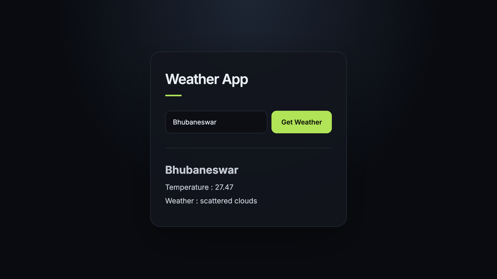

# Weather App

A simple Weather App that displays the current weather of a city using the OpenWeatherMap API.

## Features

- Search weather by city name.
- Display temperature in Celsius.
- Show weather description.
- Display an error message for invalid city names.

## Project Screenshot

## Technologies Used

- HTML
- CSS
- JavaScript
- OpenWeatherMap API

## How to Run

1. Download or clone the project.
2. Open `index.html` in your browser.
3. Enter a city name.
4. Click **Get Weather** to view the weather information.

## API

This project uses the [OpenWeatherMap API](https://openweathermap.org/api) to fetch weather data.
